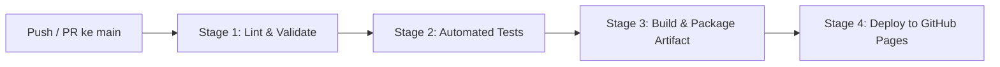

# 🥘 Website Profil Restoran "Mengan Geh" - Bandar Lampung
> **Sensasi Asli Seruit Tampah & Masakan Rumahan Tradisional Khas Lampung**

[](.github/workflows/ci-cd.yml)
[](https://nodejs.org)
[](docs/SDLC_DOCUMENTATION.md)
[](LICENSE)

---

## 📌 1. Tentang Restoran Mengan Geh
**"Mengan Geh"** adalah salah satu destinasi kuliner khas terkemuka di Kota Bandar Lampung. Diambil dari bahasa daerah Lampung yang berarti **"Ayo Makan!"**, Mengan Geh melestarikan tradisi **Nyeleruit** (makan bersama beralaskan tampah bambu dengan olahan ikan bakar/goreng, racikan sambal delan terasi asli pesisir Lampung, tempoyak durian fermentasi, dan limpahan lalapan segar).

- 📍 **Lokasi:** Jl. H. Ismail No. 1, Rajabasa, Kec. Rajabasa, Kota Bandar Lampung, Lampung 35144 (Dekat Universitas Lampung / Terminal Rajabasa)
- 🗺️ **Google Maps:** [Buka Titik Restoran di Google Maps](https://www.google.com/maps/place/Mengan+Geh/@-5.4182964,104.9439357,11.03z/data=!4m11!1m2!2m1!1sRestoran!3m7!1s0x2e40c5d7c26372c5:0x9d2cecbb27d97e87!8m2!3d-5.3567562!4d105.2395415!10e9!15sCghSZXN0b3JhbloKIghyZXN0b3JhbpIBCnJlc3RhdXJhbnSaASNDaFpEU1VoTk1HOW5TMFZKUTBGblNVUXRYMkpJZFVaUkVBReABAPoBBAgAEDI!16s%2Fg%2F11fmst80z8?entry=ttu)
- 📞 **Kontak WhatsApp:** [0815-4144-6388](https://wa.me/6281541446388) / 0823-7674-7987
- 📸 **Instagram:** [@mengangeh](https://www.instagram.com/mengangeh)
- 🕒 **Jam Operasional:** Buka Setiap Hari (10.00 – 21.30 WIB)

---

## 🚀 2. Fitur Utama Website
1. **Interactive Menu Explorer:** Katalog menu komplit (Seruit Tampah, Aneka Nasi, Lauk Pilihan, Sambel Delan & Lalap, Sayuran, Minuman) dengan filter kategori real-time, pencarian instan, dan modal rincian komposisi.
2. **Kalkulator Estimasi Katering & Nasi Kotak:** Simulasi hitungan otomatis pesanan acara kantor, arisan, syukuran, atau hajatan dengan aturan diskon volume (diskon 5% untuk &ge; 50 porsi, diskon 10% untuk &ge; 100 porsi) serta direct export format pesan ke WhatsApp.
3. **Formulir Reservasi Meja Online:** Validasi input penanggung jawab, tanggal, jam operasional, jumlah tamu, dan preferensi area (Lesehan / Meja Reguler / VIP) yang otomatis terhubung ke WhatsApp Admin.
4. **Indikator Live Jam Buka:** Deteksi otomatis status operasional restoran (Buka Sekarang / Sedang Tutup) berdasarkan waktu perangkat pengguna.
5. **Google Maps Embed & Routing:** Integrasi peta presisi langsung ke titik koordinat `-5.3567562, 105.2395415`.
6. **SEO & Schema.org JSON-LD:** Structured Data standar Google Search untuk entitas `Restaurant` dan `FoodEstablishment`.
7. **Accessibility (A11y) & Mobile First:** Desain sepenuhnya responsif untuk smartphone, tablet, dan desktop dengan navigasi keyboard yang ramah.

---

## 🛠️ 3. Penerapan SDLC (Software Development Life Cycle)
Proyek ini dikembangkan secara disiplin melalui 5 fase SDLC:

| Tahap SDLC | Aktivitas & Output |
| :--- | :--- |
| **Tahap 1: Planning & Requirements** | Analisis kebutuhan bisnis Mengan Geh, target pengguna (keluarga, instansi, mahasiswa), perumusan kebutuhan fungsional & non-fungsional. |
| **Tahap 2: System & UI/UX Design** | Perancangan Jamstack Architecture, penentuan Design Tokens (Warm Chili Red `#C83E1E`, Turmeric Gold `#D97706`), wireframing responsif. |
| **Tahap 3: Implementation** | Pengkodean modular ES Modules (`menu-renderer.js`, `calculator.js`, `reservation.js`, `ui.js`), stylesheet CSS modern tanpa runtime bloat. |
| **Tahap 4: Testing & Quality Assurance** | Unit testing otomatis (20 test cases lulus 100%), validasi markup semantic, accessibility test, dan syntax linting. |
| **Tahap 5: Deployment & Maintenance** | Automasi rilis dengan GitHub Actions CI/CD pipeline menuju GitHub Pages. |

> 📖 *Dokumentasi SDLC lengkap dapat dibaca di: [`docs/SDLC_DOCUMENTATION.md`](docs/SDLC_DOCUMENTATION.md)*

---

## 🔄 4. Penerapan CI/CD (Continuous Integration & Continuous Deployment)
Pipeline diatur dalam berkas [`.github/workflows/ci-cd.yml`](.github/workflows/ci-cd.yml) dengan 4 stage terotomatisasi:



1. **Stage 1: Code Linting & Validation (`lint-and-validate`)**
   - Memeriksa integritas seluruh berkas proyek.
   - Menjalankan syntax checker Node.js pada seluruh berkas JavaScript.
2. **Stage 2: Automated Testing (`automated-tests`)**
   - Menjalankan suite test `npm test` menggunakan Node.js test runner bawaan.
   - Menguji logika kalkulator katering, formulir reservasi, integritas data menu, dan validitas HTML.
3. **Stage 3: Build & Package Artifact (`build-artifact`)**
   - Mengompilasi dan mengemas aset ke direktori `dist/`.
   - Mengunggah artefak siap deploy.
4. **Stage 4: Automated Production Deployment (`deploy-production`)**
   - Menerapkan artefak ke GitHub Pages dengan environment check.

---

## 💻 5. Panduan Menjalankan Proyek Secara Lokal

### Prasyarat:
- Node.js versi 18 atau lebih baru (direkomendasikan Node.js 20/22/23).

### Langkah-langkah:
1. **Clone repositori:**
   ```bash
   git clone https://github.com/imamasrowardi/mengan-geh.git
   cd mengan-geh
   ```

2. **Jalankan Syntax Linter:**
   ```bash
   npm run lint
   ```

3. **Jalankan Uji Integritas Berkas:**
   ```bash
   npm run validate
   ```

4. **Jalankan Test Suite (Unit & QA Tests):**
   ```bash
   npm test
   ```

5. **Jalankan Server Lokal:**
   ```bash
   npm start
   ```
   Buka peramban Anda di: `http://localhost:3000`

---

## 📂 6. Struktur Direktori
```
menuhGEDH/
├── .github/
│   └── workflows/
│       └── ci-cd.yml          # Pipeline CI/CD GitHub Actions
├── docs/
│   └── SDLC_DOCUMENTATION.md  # Dokumen Software Development Life Cycle komprehensif
├── css/
│   └── styles.css             # Stylesheet responsif modern
├── js/
│   ├── app.js                 # Controller utama aplikasi
│   ├── data/
│   │   ├── menu-data.js       # Database menu & paket katering
│   │   └── reviews-data.js    # Informasi resto, ulasan & FAQ
│   └── modules/
│       ├── calculator.js      # Logika kalkulator katering & diskon
│       ├── menu-renderer.js   # Filter kategori & pencarian menu
│       ├── reservation.js     # Validasi formulir & generator WhatsApp
│       └── ui.js              # Interaksi modal, accordion & mobile nav
├── tests/
│   ├── calculator.test.js     # Unit test kalkulator
│   ├── markup.test.js         # Unit test semantic HTML & A11y
│   ├── menu.test.js           # Unit test kelengkapan menu
│   └── reservation.test.js    # Unit test formulir reservasi
├── scripts/
│   ├── lint.js                # Linter JavaScript mandiri
│   ├── serve.js               # HTTP server lokal
│   └── validate.js            # Validator struktur berkas
├── index.html                 # Halaman utama aplikasi
├── package.json               # Konfigurasi dependensi & npm scripts
├── .gitignore                 # Konfigurasi pengabaian Git
└── README.md                  # Dokumentasi resmi proyek
```

---

## 📄 7. Lisensi
Hak Cipta &copy; 2026 **Restoran Mengan Geh Bandar Lampung**. Seluruh kode dirilis di bawah lisensi [MIT](LICENSE).
